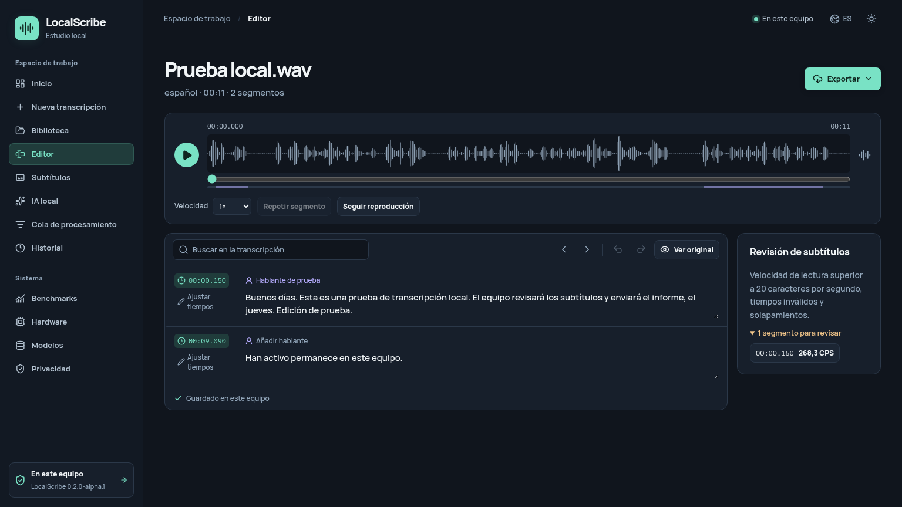
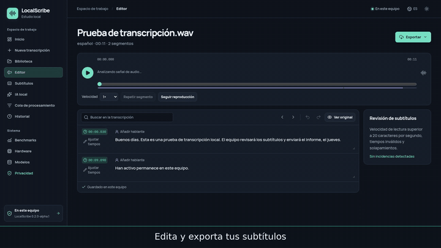
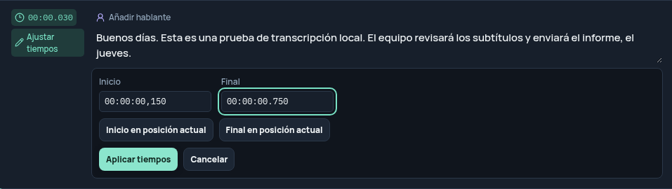
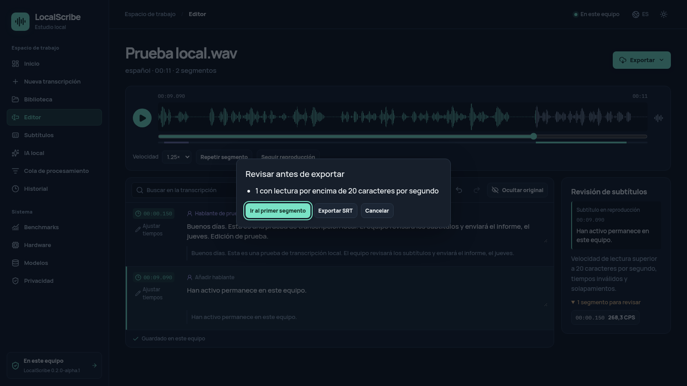

# LocalScribe

LocalScribe runs audio and video transcription on your computer. Import a recording, edit timed segments while listening, and export subtitles or text. The browser interface, FFmpeg, whisper.cpp and SQLite all run locally. Transcription works offline once FFmpeg and the model weights are installed.

## See LocalScribe in action

[Watch the full 30-second demo (MP4)](https://github.com/camilin7483/LocalScribe/releases/download/v0.2.0-alpha.1/LocalScribe-Demo-0.2.mp4) · [Download the Windows or Linux release](https://github.com/camilin7483/LocalScribe/releases/tag/v0.2.0-alpha.1)

Caption timing and export review screenshots

## Get started

1. Extract the package for your system. On Linux, install FFmpeg from your distribution. On Windows, use the included FFmpeg setup script if the tools are missing.
2. Launch LocalScribe. It opens at `http://127.0.0.1:7676` in your browser.
3. In **Models**, download the Whisper model recommended by AutoTune and **Silero VAD**. Each download shows its progress and verifies the published checksum.
4. Open **New transcription**, pick or drop recordings, choose your options and start the job. Open the finished file in **History** to edit or export it.

[Installation on Windows, Ubuntu and Arch Linux](docs/INSTALL.md) · [Build from source](docs/BUILD.md) · [Architecture](docs/ARCHITECTURE.md)

## Features

| Workflow | LocalScribe |
|---|---|
| Import | Drag and drop, file picker and batches. WAV, MP3, FLAC, M4A, OGG, AAC, MP4, MKV, MOV, WEBM and AVI with a supported audio track. |
| Transcribe | Multilingual Whisper Tiny, Base and Small Q5_1, automatic or manual language, Silero VAD and timed segments. |
| Process long recordings | Streaming upload to disk, bounded decode windows, persistent checkpoints, cancellation and resume. |
| AutoTune | Live memory, CPU topology and a startup calibration drive Eco, Balanced and Precision plans. The packaged AVX2 engine is selected when the processor supports it. |
| Edit | Audio waveform, synchronized playback and looping, caption timing to the millisecond, segment search, speaker labels, autosave, undo and redo, and access to original text and timing. |
| Export | TXT, SRT, VTT, JSON and Markdown, with a review of caption timing and reading speed in the editor. |
| Optional local AI | Six summary views, translation, correction proposals and extractive answers through Ollama. Automatic speaker proposals through optional sherpa-onnx. |
| Measure | Processing time, real-time factor, sampled peak RSS, CPU time and WER against a supplied reference. |

The interface supports English and Spanish and offers dark and light themes.

## Privacy

The server binds to IPv4 loopback. SQLite stores history and settings in your user data directory. Audio and video stay in that directory until you delete the job in the application. Downloads contact Hugging Face for published weights. The optional Ollama adapter connects to a loopback server after you enable it and invoke an action. Install Ollama in local-only mode before using it with private text.

[Privacy and data handling](docs/ARCHITECTURE.md#privacy-and-storage) · [Set up optional engines](docs/LOCAL_AI.md)

## Verify and contribute

Use the smoke test to exercise the packaged runtime with real recordings. The full test suite includes the supported container matrix and a restart/resume test. The browser test covers imports, playback, edits and subtitle downloads. See the measured results, reproduction commands and known limits before publishing artifacts.

| Check | Result |
|---|---|
| Packaged app | The full browser workflow passed on Arch Linux with networking isolated and against the Windows executable under Wine. Ubuntu Base 24.04.5 passed a startup smoke test. [Verification report](docs/VERIFICATION-0.2.md) |
| Accessibility | axe-core reported zero violations in four tested editor states. [Report](docs/measurements/0.2-accessibility.json) |
| Recognition | On 24 FLEURS recordings, Eco with Base moved from 19.5% to 7.1% word error rate in Spanish and from 18.8% to 13.1% in English relative to Tiny. [Per-recording results](docs/measurements/0.2-fleurs.json) |
| Processing with long silences | On a six-minute track with digital silence, median processing time fell from 12.149 s to 8.700 s across three runs per version. All six runs produced identical subtitle text and timestamps. [Measurement](docs/measurements/0.2-silence-release.json) |

[Earlier verification](docs/VERIFICATION.md) · [Benchmark methodology](docs/BENCHMARKS.md) · [Demo reproduction](docs/DEMO.md) · [Changelog](CHANGELOG.md)

## Contributors

| GitHub account | Role |
|---|---|
| [@camilin7483](https://github.com/camilin7483) | Project owner and maintainer |

[GitHub contributor activity](https://github.com/camilin7483/LocalScribe/graphs/contributors)

LocalScribe is licensed under the MIT License. [License](LICENSE) · [Third-party attributions](docs/ATTRIBUTIONS.md)
